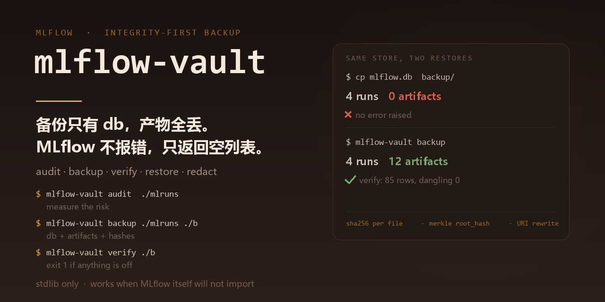

# mlflow-vault



**Backup, verify and restore an MLflow tracking store — including the artifacts, not just the database.**

MLflow keeps your experiments in two places that are only loosely coupled: a
SQLite database holding runs, params, metrics and an `artifact_uri` *string* per
run, and the artifact files that string points at. Back up the database alone and
you get a store that opens perfectly, lists every run, reports no error — and
returns zero artifacts. That failure is silent, which is why it survives.

`mlflow-vault` is a single-command answer to "is this backup actually restorable":

```bash
mlflow-vault audit   ./mlruns                 # measure the risk, with evidence
mlflow-vault backup  ./mlruns ./backup-2026-10-20
mlflow-vault verify  ./backup-2026-10-20      # exit 1 if anything is off
mlflow-vault restore ./backup-2026-10-20 /srv/new-store
mlflow-vault drill                            # rehearse the whole thing
```

No dependencies at runtime (stdlib only), so it still works when MLflow itself
will not import. Python 3.9+.

---

## The four hazards it exists for

| Hazard | What it looks like | What this tool does |
|---|---|---|
| **Absolute `artifact_uri`** | DB copies fine; every artifact link dies on another machine | rewrites the base prefix on restore, then proves `dangling = 0` |
| **WAL sidecar loss** | newest runs vanish; the restored DB looks healthy | snapshots via the SQLite backup API, folds the WAL in, converts to one self-contained file |
| **DB-only backup** | verification "passes" because nothing checks artifacts | per-run artifact coverage; a db-only package is reported as critical, not OK |
| **Credentials in params/tags** | every backup copy is a copy of your API keys | fingerprints in the manifest, `secrets.json` ledger, `redact` for shareable copies |

## What is in a backup

A backup is a plain directory — no tar, no compression, no custom container, so
`ls` and `sha256sum` work on it:

```
backup-2026-10-20/
  manifest.json     every file: sha256 + size + origin, plus the DB's logical digest
  secrets.json      where credentials live (sha256 + length + location only)
  db/mlflow.db      consistent snapshot, WAL folded in, journal_mode=delete
  mlruns/…          byte-for-byte copy of every run's artifact tree
  RESTORE.md        the recovery procedure, inside the package
  .gitignore        refuses to let the backup be committed by accident
```

`manifest.json` records a `root_hash` over all file digests, so two backups of the
same store compare with one string, and any single changed byte changes it.

## Verify: three questions, not one

`verify` checks bytes, structure **and meaning**, because they fail independently:

1. **Bytes** — every file matches its recorded digest (`--shallow` skips hashing for a fast size-only pass).
2. **Structure** — anything the manifest promised but that is missing, and anything present that the manifest never recorded.
3. **Meaning** — the database still holds the same rows, compared as a per-table digest of row *content*. `artifact_uri` is excluded from that digest, which is what makes "the rows survived the move" checkable even though the paths were rewritten.

Plus a fourth check that is the whole point: **does every run still have artifact
files?** Not "does the directory exist" — files, because an empty directory is the
shape a half-restore takes.

Exit code is 1 on any error, so it works as a cron/CI gate.

## Restore: paths are the hard part

`artifact_uri` is stored as an absolute path. Restoring elsewhere therefore needs
the strings rewritten, and rewriting them is where naive restores break:

```bash
mlflow-vault restore ./backup /srv/new-store --dry-run   # show the rewrite plan
mlflow-vault restore ./backup /srv/new-store             # fresh dir, safe default
```

* Only URIs **inside the recorded base** are rewritten. A run someone pointed at a
  custom directory keeps its URI — that was a deliberate choice, not an accident.
* Remote URIs (`s3://`, `gs://`, `mlflow-artifacts:`) are left untouched and the
  backup says so in `warnings`.
* Afterwards the logical digest is recomputed with `artifact_uri` excluded and
  compared against the manifest. A mismatch fails the restore loudly instead of
  producing a plausible-looking store.
* `RESTORE-REPORT.json` lands in the target, recording what was rewritten.

## Sensitive values: an explicit policy, not a default

MLflow params and tags are free text, and people put credentials in them. A backup
is a *new copy of those secrets on new media*, so it needs a stated policy:

| Where | Policy |
|---|---|
| `manifest.json` | **fingerprints only** — sha256, length, location. Safe to paste into a ticket or CI log. |
| `secrets.json` | ledger of *where* each secret is, never *what* it is. Mode 0600 where the platform supports it. |
| `db/mlflow.db` (in a backup) | **original values kept.** A backup that edits payloads is not a backup. Protect it with access control, not with redaction. |
| `redact` output | values replaced with `<redacted:sha256:xxxxxxxxxxxx>`, then `secure_delete` + `VACUUM`, then a raw byte scan to prove nothing survived. |

### Why `redact` needs the VACUUM

`UPDATE params SET value = '<redacted…>'` changes what a query returns. It does
**not** remove the old bytes: SQLite leaves the previous cell in the page's free
space, so `grep sk-live backup.db` still finds every secret. Measured on the
project's own fixture — after a bare UPDATE, **4 of 4** original secrets were still
byte-findable; after `secure_delete` + `VACUUM`, **0**. There is a test
(`TestSecurePurgeIsLoadBearing`) that fails if that stops being true.

A redacted package still **verifies**: the manifest is recomputed to match the new
bytes, and the original digests are kept under `redaction.original_digests` so a
reviewer can prove the only difference was the redaction.

Artifacts are **not** redacted — they are opaque files, and scanning them for
credentials is a different job. `redact` says so in its output and in the manifest.

## The drill: a backup is worth what the last restore proved

```bash
mlflow-vault drill --runs 4
```

Seven steps, each of which can fail independently:

| Step | What it proves |
|---|---|
| `build-store` | a real store exists: WAL mode, nested artifacts, secrets in params |
| `backup` | the package is built |
| `verify-clean` | an untouched package verifies |
| `tamper-detect` | three separate damage modes are each caught **and named** |
| `restore` | rows match, URIs rewritten, zero dangling |
| `readback` | the **MLflow SDK itself** re-reads every run, metric and artifact |
| `negative-control` | a db-only copy *does* lose artifacts — proving the check can detect the failure it claims to prevent |

The last step is the one that matters. Its first implementation proved nothing: the
db-only copy "worked" because the absolute `artifact_uri` still pointed at the
original store, which was sitting right there on disk. That is exactly why the bug
survives in production — nothing breaks until the original machine is gone. The
control now moves the artifact tree away first, and fails the drill if a db-only
copy ever looks healthy.

Real output from this repository:

```
[PASS] build-store        4 runs, [4096, 4096, 4096, 4096] artifacts written (7.6s)
[PASS] backup             14 files / 973319 bytes / 8 secrets logged (0.2s)
[PASS] verify-clean       14 files hashed, 973319 bytes, 85 rows, errors=0
[PASS] tamper-detect      artifact-byte-flip:CAUGHT; artifact-deleted:CAUGHT; db-truncated:CAUGHT
[PASS] restore            12 artifacts copied, 85 rows matched, 4 URIs rewritten, dangling=0
[PASS] readback           MLflow SDK re-read 4 runs / 12 top-level artifacts
[PASS] negative-control   db-only copy after artifact loss: 4/4 dirs dangling, SDK readback failed
=> DRILL PASSED
```

## Commands

| Command | Purpose |
|---|---|
| `audit <store> [--backup PKG] [--fail-on LEVEL]` | risk report with the evidence behind each finding |
| `backup <store> <out> [--overwrite] [--no-secrets-ledger]` | build a package |
| `verify <pkg> [--shallow] [--json]` | prove the package is complete; exit 1 on error |
| `restore <pkg> <target> [--dry-run] [--force] [--keep-artifacts]` | restore elsewhere |
| `redact <pkg> [--out DIR] [--in-place] [--dry-run]` | shareable copy, secrets masked |
| `secrets <pkg>` | list where credentials live (fingerprints only) |
| `compare <pkgA> <pkgB>` | diff two packages of the same store |
| `drill [--workdir DIR] [--runs N]` | full rehearsal |

Every command accepts `--json` where the output is structured.

## What it deliberately does not do

* **Download remote artifacts.** It records `s3://…` URIs and warns; back the
  bucket up with the provider's own tooling (versioning + lifecycle).
* **Restore over a live store by default.** A fresh directory is the safe default
  and is what proves the package is complete; `--force` exists for the other case.
* **Scan artifact payloads for secrets.** Opaque files, different job, and the
  manifest says so.
* **Replace your scheduler.** It is a CLI with honest exit codes, meant to be
  called from cron, a workflow, or a pre-upgrade step.

## Install

```bash
pip install -e ".[dev]"      # library + tests
pip install -e ".[drill]"    # adds the mlflow SDK, only needed for `drill`
```

## Tests

```bash
pytest            # 286 tests
ruff check src tests
```

The suite builds MLflow stores with plain SQL (no SDK needed), so it runs on a bare
interpreter. Several tests are written as *"this package is broken and must be
caught"* — a verifier that returns OK for a db-only package has the exact failure
mode it was hired to prevent.

## License

Apache-2.0.
